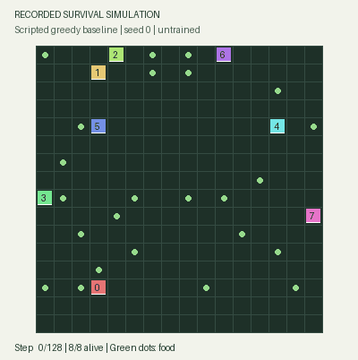

# Survival Agent Pilot

[](https://clarkwhitehead.com/)

**Actual recorded run · scripted greedy baseline · no trained result.** Click the preview for the replay controls on the website.

A small, inspectable multiagent survival research scaffold. **This is an engineering prototype, not evidence of learned survival, emergent cooperation or continual learning.**

Start reading:

- [Stage-B recurrent world-model survival smoke and measured limitations](docs/hybrid-stage-b.md)
- [MuZero-style model, PUCT MCTS, replay and recurrent losses](https://github.com/Nova-Rift/survival-agent/blob/main/survival_agent/muzero.py)
- [Small transformer-history agent](https://github.com/Nova-Rift/survival-agent/blob/main/survival_agent/agent.py)
- [Local pretrained/scratch language backend](https://github.com/Nova-Rift/survival-agent/blob/main/survival_agent/language_backend.py)
- [Language-feature-to-latent controller](https://github.com/Nova-Rift/survival-agent/blob/main/survival_agent/integrated.py)
- [Actor-critic baseline trainer/evaluator](https://github.com/Nova-Rift/survival-agent/blob/main/survival_agent/training.py)
- [Simulator and observation-limited baselines](https://github.com/Nova-Rift/survival-env/blob/main/survival_env/simulator.py)
- [Developer guide: quickstart, interfaces and extension examples](docs/developers.md)
- [Security scope and limitations](SECURITY.md)

## Repositories and ownership

| Repository | Canonical source |
|---|---|
| [survival-env](https://github.com/Nova-Rift/survival-env) | NumPy-only environment, communication, recording and baseline runner. |
| [survival-agent](https://github.com/Nova-Rift/survival-agent) | Model/search/backend/serialization code and legacy forwarding imports. |
| This pilot repository | `survival_adapters/`, examples, integration tests, documentation and recorded demo assets. |

There are no independently maintained copies of the environment or model source here. Earlier commits and URLs remain in this repository's history. [Source pins and local workflow](docs/repositories.md) identify exactly which extracted commits are used.

## Environment

Environment and model source are owned by separate repositories. Clone them as siblings before running integration commands. Dependency installation and a fresh resolved environment remain untested.

16×16 grid; eight initially equal agents; move/wait actions; food, hunger and death; 5×5 local observations. Simultaneous contested moves reject all contenders. Reward is one per agent alive after a transition, zero otherwise. Seeded bounded episodes and private observation histories are implemented. Optional plain-text communication is range-limited; no cooperation reward is added.

## Distinct learning paths

The **actor-critic baseline** uses fresh on-policy survival data and auxiliary observed-transition reward/dynamics targets. The separate **minimal MuZero-style option** uses actual PUCT visit-frequency policy targets, episode replay, n-step values and recurrent unroll losses. It is not a full MuZero reproduction: deterministic latent transitions approximate a partially observed world with interacting agents. No validated planning advantage is claimed.

Scratch MuZero training updates its small observation transformer, dynamics and heads. The optional language-feature route uses a frozen local encoder and trainable projection/latent heads. Pretrained encoder fine-tuning is explicitly unsupported. The separate fully scratch language configuration uses random weights and a fixed UTF-8 byte vocabulary; natural-language competence is not claimed.

Pretrained language defaults to Qwen/Qwen2.5-0.5B-Instruct at revision `7ae557604adf67be50417f59c2c2f167def9a775`. Weights are not included. Loading is local-directory-only, safetensors-only and `trust_remote_code=False`. The optional `scripts/fetch_qwen.py` helper downloads only that pinned official artifact when explicitly invoked. The model's license is Apache-2.0; no project license has been selected.

## Local setup

First follow the [three-checkout workflow](docs/repositories.md). The shell examples assume the sibling checkout paths are available through `PYTHONPATH`.

Clean installation with the recommended versions is not yet verified. See the [developer setup and test status](docs/developers.md). The commands below are setup instructions, not a claim that a fresh environment was tested.

Use a fresh virtual environment with Python 3.10+ and the security-oriented dependency minimums in `requirements-language.txt`. Do not reuse an unpatched ML environment for untrusted files. See SECURITY.md for advisory review and compatibility limits.

```bash
python -m venv .venv
. .venv/bin/activate
python -m pip install -r requirements-language.txt
python -B -m unittest discover -v
```

No package installation is performed by project scripts. The current publication was functionally checked on the pre-existing legacy runtime; the newly recommended dependency combination has not been fully retested. This is not a security certification of that legacy runtime.

## Bounded examples

Use new output directories. These commands are small engineering checks, not scientific training runs:

```bash
# Recorded scripted baseline and offline replay.html
python -B -m survival_agent.run --policy greedy --seed 0 --steps 128 --output runs/baseline

# Minimal MuZero-style scratch collection/replay update
OMP_NUM_THREADS=1 timeout 20s python -B -m survival_agent.muzero_run --output runs/muzero --steps 4 --simulations 8 --updates 1 --max-seconds 8

# Actor-critic collection/training/evaluation remain separate
OMP_NUM_THREADS=1 timeout 20s python -B -m survival_agent.training collect --output runs/data --max-joint-steps 2
OMP_NUM_THREADS=1 timeout 20s python -B -m survival_agent.training train --output runs/ac --max-joint-steps 2
OMP_NUM_THREADS=1 timeout 20s python -B -m survival_agent.training evaluate --checkpoint runs/ac/checkpoint.safe --output runs/eval --eval-seeds 1001 --horizon 2 --max-joint-steps 8
```

Checkpoint/resume uses schema-validated JSON and safetensors in a bounded archive, **not pickle or torch.load**. Legacy checkpoint formats are rejected. The MuZero learner supports exact next replay-update resume at episode boundaries; the actor-critic checkpoint also captures environment/history/sampler state. Runtime limits are cooperative at step boundaries; shell `timeout` gives a hard process cap.

## Limits

No useful learned policy, language cooperation, humanlike civilization, generalization, or cross-world retention is established. Speech learning, independent-agent optimization, large populations, pretrained fine-tuning, full MuZero scaling/reanalysis and meaningful scientific evaluation remain future work. No GPU, API service or network server is started automatically.

This repository contains curated source and a recorded preview with provenance. Model weights, checkpoints, raw run datasets, personal context and earlier private development history are excluded. Existing local work/history was preserved separately; this is a clean public source history rather than a rewritten remote history.
